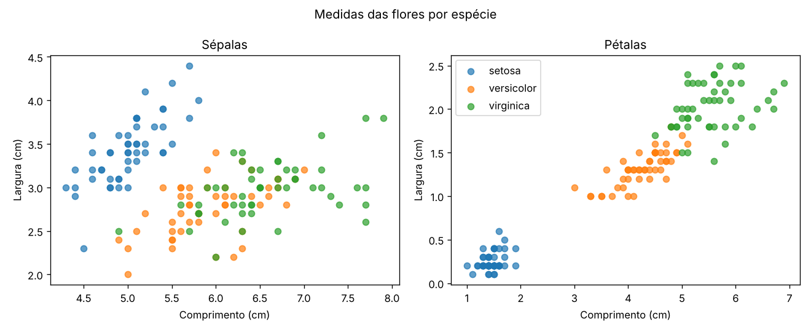
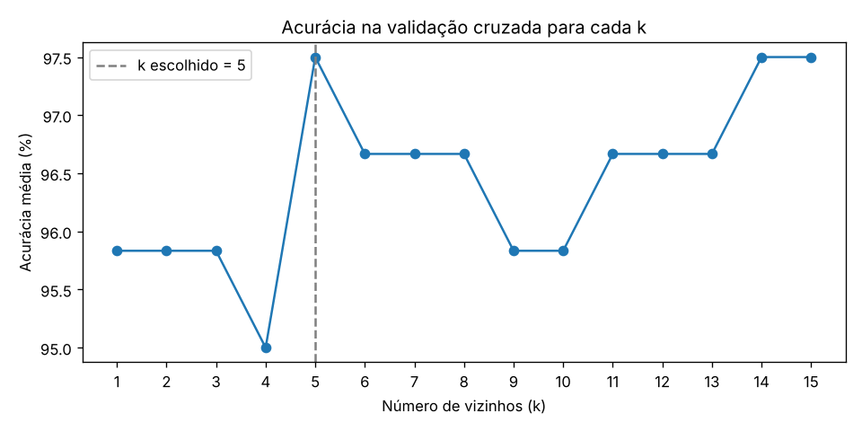
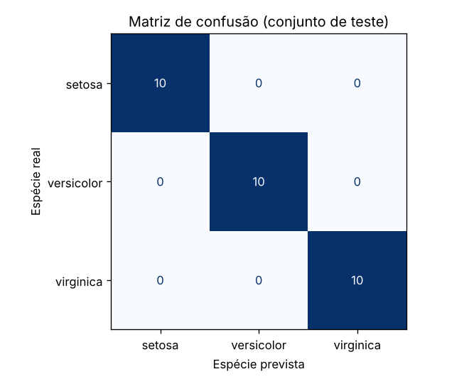

# Classificação de espécies de Iris com KNN

Modelo de machine learning que identifica a espécie de uma flor Iris (*setosa*, *versicolor* ou *virginica*) a partir de 4 medidas da flor. O projeto cobre o processo completo: análise exploratória, escolha do modelo com validação cruzada, avaliação, salvamento do modelo e um script de linha de comando para classificar flores novas.

## Resultados

| Etapa | Resultado |
|---|---|
| Modelo escolhido | KNN com `k = 5` (escolhido por validação cruzada entre k = 1 e 15) |
| Validação cruzada (5 partes, 120 flores de treino) | **97,5%** de acurácia média |
| Conjunto de teste (30 flores) | **100%** (30 de 30) |
| Comparação | Regressão logística: 95,8% · Árvore de decisão: 95,0% |

Os poucos erros na validação cruzada (3 de 120) aconteceram entre *versicolor* e *virginica*, as duas espécies com medidas mais parecidas. A *setosa* nunca foi confundida.

> O acerto de 100% no teste vem de um conjunto pequeno (30 flores). A estimativa mais realista do desempenho é a da validação cruzada, de 97,5%.

### Medidas por espécie

As medidas das pétalas separam bem as espécies. A *setosa* fica isolada, e *versicolor* e *virginica* se sobrepõem um pouco.



### Escolha do k e matriz de confusão

<p>
  
  
</p>

## Tecnologias

- **Python**
- **Pandas**: manipulação e análise dos dados
- **Scikit-Learn**: KNN, validação cruzada, métricas e comparação de modelos
- **Matplotlib**: gráficos
- **Joblib**: salvar e carregar o modelo
- **Pytest**: testes automatizados

## Estrutura do projeto

```
classificacao-iris/
├── notebooks/
│   └── classificacao_iris.ipynb   # análise, treino e avaliação do modelo
├── modelo/
│   └── modelo_iris.pkl            # modelo salvo pelo notebook
├── imagens/                       # gráficos gerados pelo notebook
├── tests/
│   └── test_prever.py             # testes do script de previsão
├── prever.py                      # classifica uma flor nova pela linha de comando
├── requirements.txt
└── pytest.ini
```

## Como executar

Testado com Python 3.13. Os comandos abaixo são para Windows. No Linux ou macOS, ative o ambiente com `source .venv/bin/activate`.

```bash
# 1. Clonar o repositório
git clone https://github.com/moreiralivia80-oss/classificacao-iris.git
cd classificacao-iris

# 2. Criar e ativar um ambiente virtual
python -m venv .venv
.venv\Scripts\activate

# 3. Instalar as dependências
pip install -r requirements.txt
```

### Classificar uma flor

Informe as 4 medidas em centímetros, nesta ordem: comprimento da sépala, largura da sépala, comprimento da pétala e largura da pétala.

```bash
python prever.py 6.3 3.3 6.0 2.5
```

```
Espécie identificada: virginica
  setosa: 0%
  versicolor: 0%
  virginica: 100%
```

O script aceita vírgula como separador decimal (`6,3`), recusa medidas menores ou iguais a zero e avisa quando alguma medida está fora da faixa vista no treino, já que nesses casos o resultado pode não ser confiável.

### Rodar o notebook

Abra `notebooks/classificacao_iris.ipynb` no VS Code (extensão Jupyter) ou no Jupyter, selecione o Python do `.venv` como kernel e execute todas as células. O notebook gera de novo o modelo em `modelo/` e os gráficos em `imagens/`.

### Rodar os testes

```bash
pytest
```

## O que aprendi

- A importância da **análise exploratória** antes de treinar: o gráfico das pétalas já indicava quais espécies o modelo poderia confundir.
- Usar **validação cruzada** para escolher hiperparâmetros (o `k`) sem usar o conjunto de teste, e por que ela é mais confiável que um único teste pequeno.
- Avaliar além da acurácia, com **matriz de confusão** e **relatório de classificação**.
- **Validar entradas** antes de usar um modelo: ele sempre devolve uma resposta, mesmo para medidas impossíveis.
- Salvar o modelo junto com as informações necessárias para usá-lo depois (nomes das colunas, classes, limites e versão do Scikit-Learn).

# autora e git hub

**Lívia Moreira Teixeira**, estudante de Análise e Desenvolvimento de Sistemas.
[GitHub](https://github.com/moreiralivia80-oss)
